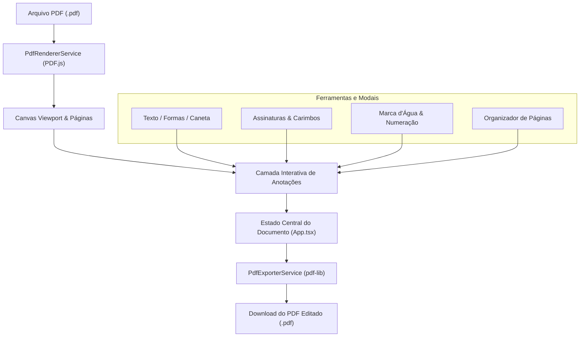

# DocuCraft PDF Studio (PDF-Craft)

> Um editor e manipulador de documentos PDF moderno, completo, intuitivo e com foco em privacidade local (*offline-first*), desenvolvido com React 19, TypeScript e Vite.

[](LICENSE)
[](https://react.dev/)
[](https://www.typescriptlang.org/)
[](https://tailwindcss.com/)

---

## 📋 Sumário
- [Visão Geral](#-visão-geral)
- [Funcionalidades Principais](#-funcionalidades-principais)
- [Arquitetura e Fluxo de Dados](#-arquitetura-e-fluxo-de-dados)
- [Tecnologias Utilizadas](#-tecnologias-utilizadas)
- [Atalhos de Teclado](#-atalhos-de-teclado)
- [Como Executar o Projeto](#-como-executar-o-projeto)
- [Estrutura de Pastas](#-estrutura-de-pastas)
- [Licença](#-licença)

---

## 🌟 Visão Geral

O **DocuCraft PDF Studio** foi projetado para oferecer uma suíte de edição de PDFs diretamente no navegador, eliminando a necessidade de envio de arquivos confidenciais para servidores de terceiros. Toda a renderização, manipulação, anotação e compilação do PDF final é executada **localmente no cliente** através da combinação das bibliotecas `PDF.js` e `pdf-lib`.

---

## 🚀 Funcionalidades Principais

### 1. Manipulação e Organização de Páginas
- **Reordenação de Páginas:** Mova páginas livremente no organizador visual.
- **Rotação Precisa:** Gire páginas individualmente em ângulos de 90° no sentido horário ou anti-horário.
- **Exclusão e Duplicação:** Remova páginas indesejadas ou duplique seções mantendo a integridade das anotações existentes.
- **Inserção de Páginas em Branco:** Adicione folhas A4 para notas adicionais ou termos suplementares.
- **Mesclagem de PDFs (Merge):** Junte múltiplos documentos PDF em um único arquivo unificado.
- **Extração Individual:** Baixe páginas selecionadas como documentos avulsos.

### 2. Anotações e Elementos Visuais
- **Caixas de Texto:** Formatação completa com escolha de tamanho de fonte, alinhamento, cores, negrito, itálico e sublinhado.
- **Caneta Livre e Marca-Texto:** Desenho livre com espessura ajustável e marcação translúcida para realce de trechos.
- **Formas Geométricas:** Retângulos, círculos, linhas retas e setas direcionais vetoriais.
- **Tarjas de Censura (Redaction):** Bloqueio opaco definitivo de dados sensíveis e pessoais (LGPD/compliance).
- **Notas Adesivas (Sticky Notes):** Comentários flutuantes com personalização de cores estilo post-it.
- **Carimbos Oficiais e Personalizados:** Modelos prontos (`APROVADO`, `PAGO`, `CONFIDENCIAL`, `URGENTE`, `REVISADO`, etc.) e criação de carimbos sob medida com carimbo de data automático.

### 3. Assinatura Digital e Rubricas
- **Desenhar Assinatura:** Painel de assinatura com suporte a mouse, touchpad ou caneta stylus touch.
- **Digitar Nome (Tipográfica):** Geração de assinaturas caligráficas com estilos cursivos elegantes (`Dancing Script`, `Caveat` e clássica formal).
- **Upload de Imagem:** Importação de imagem com remoção inteligente de fundo branco via algoritmo de transparência local.

### 4. Segurança e Identificação Documental
- **Marca d'Água Dinâmica:** Inserção de texto em todas as páginas com ângulo, tamanho de fonte, opacidade e cor customizáveis.
- **Numeração Automática de Páginas:** Numeração configurável (ex: *Página X de Y*, *X / Y*, *Pág. X*), com opção de ignorar capa e definição de posição (cabeçalho ou rodapé).

### 5. Histórico e Produtividade
- Suporte total a **Desfazer (Undo)** e **Refazer (Redo)** para todas as alterações.
- Zoom contínuo com ajuste à largura e resolução HiDPI com renderização nítida.
- Modelos prontos pré-configurados (Contrato comercial, Relatório de KPIs e Documento em branco).

---

## 📐 Arquitetura e Fluxo de Dados

A aplicação opera através de um pipeline desacoplado onde o carregamento/leitura é governado pelo `pdfRenderer` (`PDF.js`), a camada interativa é gerida pelo React, e a compilação final é construída pelo `pdfExporter` (`pdf-lib`):



---

## ⌨️ Atalhos de Teclado

| Tecla / Atalho | Ação |
| :--- | :--- |
| `Ctrl + Z` / `Cmd + Z` | Desfazer última anotação/ação |
| `Ctrl + Y` / `Cmd + Shift + Z` | Refazer ação desfeita |
| `Delete` / `Backspace` | Excluir elemento selecionado |
| `Esc` | Desmarcar elemento selecionado e voltar à ferramenta de seleção |
| `V` | Selecionar ferramenta de cursor |
| `T` | Selecionar ferramenta de texto |
| `P` | Selecionar caneta de desenho livre |
| `H` | Selecionar marca-texto |

---

## 🛠️ Tecnologias Utilizadas

- **Interface:** [React 19](https://react.dev/) com Hooks e Componentes Funcionais.
- **Linguagem:** [TypeScript](https://www.typescriptlang.org/) com tipagem estrita.
- **Renderização e Visualização de PDF:** [PDF.js](https://mozilla.github.io/pdf.js/) (`pdfjs-dist`).
- **Manipulação e Exportação de PDF:** [pdf-lib](https://pdf-lib.js.org/).
- **Estilização e Design:** [Tailwind CSS v4](https://tailwindcss.com/) com classes utilitárias e paleta neutra/índigo.
- **Ícones:** [Lucide React](https://lucide.dev/).
- **Efeitos e Animações:** Canvas-confetti e Motion.
- **Build Tool:** [Vite](https://vite.dev/).

---

## 💻 Como Executar o Projeto

### Pré-requisitos
- [Node.js](https://nodejs.org/) versão 18 ou superior instalado.
- Gerenciador de pacotes `npm`, `pnpm` ou `bun`.

### Instalação e Execução

1. Clone o repositório ou navegue até o diretório raiz:
   ```bash
   cd PDF-Craft
   ```

2. Instale as dependências:
   ```bash
   npm install
   ```

3. Inicie o servidor de desenvolvimento:
   ```bash
   npm run dev
   ```

4. Abra seu navegador em `http://localhost:3000`.

### Scripts Disponíveis

- `npm run dev`: Inicia o servidor Vite na porta 3000.
- `npm run build`: Compila a aplicação otimizada para produção.
- `npm run preview`: Visualiza o bundle gerado localmente.
- `npm run lint`: Valida tipos com `tsc --noEmit`.

---

## 📂 Estrutura de Pastas

```text
PDF-Craft/
├── index.html                 # Ponto de entrada HTML com fontes Google Fonts
├── package.json               # Dependências e scripts do projeto
├── tsconfig.json              # Configurações do TypeScript
├── vite.config.ts             # Configuração do Vite e Tailwind
├── LICENSE                    # Licença MIT
├── README.md                  # Documentação do projeto
└── src/
    ├── main.tsx               # Inicialização da raiz do React
    ├── App.tsx                # Gerenciador de estado principal e orquestrador
    ├── index.css              # Estilos globais e fontes personalizadas
    ├── components/            # Componentes visuais e modais
    │   ├── AnnotationElement.tsx  # Renderizador e manipulador interativo de anotações
    │   ├── CanvasViewport.tsx     # Viewport de rolagem com renderização das páginas
    │   ├── PageManagerModal.tsx   # Modal de organização, reordenação e mesclagem
    │   ├── PageNumberModal.tsx    # Modal de configuração de numeração de páginas
    │   ├── PropertiesBar.tsx      # Barra flutuante contextual de propriedades
    │   ├── SampleDocsModal.tsx    # Modal de seleção de modelos prontos
    │   ├── Sidebar.tsx            # Barra lateral com miniaturas e camadas
    │   ├── SignatureModal.tsx     # Modal de criação de assinaturas digitais
    │   ├── StampPickerModal.tsx   # Modal de carimbos oficiais e personalizados
    │   ├── ToolRibbon.tsx         # Barra de ferramentas superior
    │   ├── TopBar.tsx             # Cabeçalho com ações de exportação e título
    │   └── WatermarkModal.tsx     # Modal de marca d'água
    ├── services/              # Serviços de manipulação de PDF
    │   ├── pdfExporter.ts     # Compilação e download de PDF com pdf-lib
    │   ├── pdfRenderer.ts     # Carregamento e renderização com PDF.js
    │   └── samplePdfs.ts      # Modelos programáticos para demonstração
    └── types/
        └── pdf.ts             # Tipos e interfaces TypeScript
```

---

## 📄 Licença

Distribuído sob a licença **MIT**. Consulte o arquivo [LICENSE](LICENSE) para obter mais informações.

